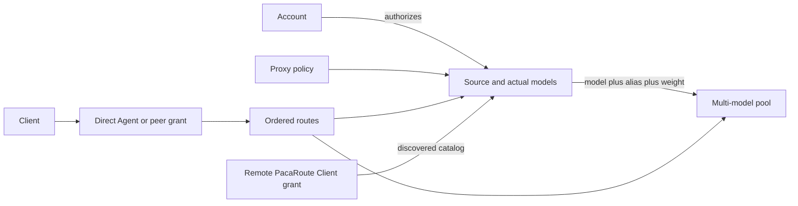
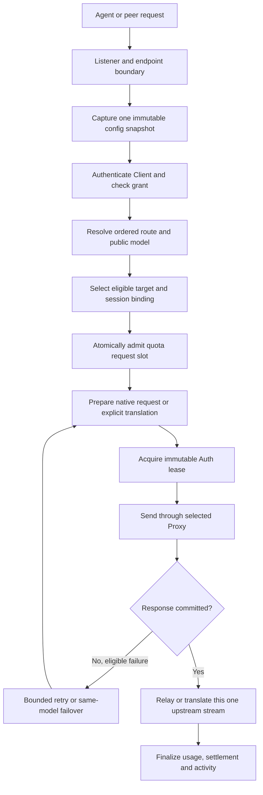

# PacaRoute architecture and refactoring design

PacaRoute is a personal and team model gateway. It connects existing coding
Agents to multiple provider accounts, exposes controlled model catalogs, routes
sessions across compatible sources, and records usage. A remote PacaRoute can
itself be a source. The refactor should make these responsibilities independently
understandable and testable while preserving the deployed product's behavior.

Scope: the Go 1.26 runtime and React/TypeScript management UI in the current 0.9
working tree, reviewed on 2026-11-02. Sections 1–7 describe product contracts;
sections 8–10 propose internal organization and a migration sequence. The target
package structure is a design proposal, not an already implemented architecture.

Read `AGENTS.md` first. Current Go code, its contract tests, `docs/pacaroute.md`
and `docs/pacaroute-web-desktop.md` establish the starting behavior. Resolve
conflicts explicitly rather than silently choosing a document. Older
`docs/design.md` and `docs/pipeline-design.md` describe historical .NET/AOT and
hub-IR decisions; retain their relevant wire evidence without recreating that
runtime or treating their old roadmap as the current product scope.

## 1 Product boundaries

Users should be able to:

1. Add an account, authorize it, discover a resource and select its models.
2. Use a source directly or combine sources into a weighted multi-model pool.
3. Create a Client, grant specific access, select models and configure its Agent.
4. Inspect actual source/model usage, failures, cooldowns and local cost estimates.
5. Share a Client using a connection script or QR code, including with another
   PacaRoute installation.
6. Export configuration and import it into another workspace with add or replace
   semantics, then reauthorize the imported accounts.
7. Stop model serving while continuing to edit configuration in the management UI.

The deployment remains one Go process with an embedded static web UI. The desktop
shell is a system tray, not an Electron/Wails application. Node is required for
building the frontend, not for production. Keep macOS, Windows and CLI/server
distributions. An internal refactor does not require microservices, Redis, an
external database, a plugin marketplace or a new Agent orchestration system.

PacaRoute does not execute the user's tools or manage their project workflows.
The calling Codex/Claude client owns that execution. A successful upstream HTTP
response alone therefore cannot establish Agent compatibility.

## 2 Domain model

| Object | Meaning and ownership | Relationships |
| --- | --- | --- |
| Account | Provider identity and authorization metadata; Auth owns its secret material | One account can authorize multiple sources |
| Source | A concrete resource/endpoint and configured actual models/deployments | Uses an account; may override its API key and select a Proxy |
| Model capability | A model ID plus supported Agent/protocol paths | Discovery informs selection; discovery does not itself grant Client access |
| Pool | A virtual source exposing public model aliases for a supported Agent | Contains source/model/alias/weight members |
| Client | An authenticated downstream caller and its permissions, routes and quota policy | Has direct Agent grants and/or an independent PacaRoute grant |
| Route | An ordered mapping from grant/Agent and requested alias to target/model | Targets a Source or `pool:<id>` |
| Proxy | An outbound connection policy | Source bindings and account-login Proxy selection are distinct |
| Binding | A session's chosen pool member and endpoint identity | Runtime state, not portable configuration |
| Cooldown | Failure/throttle state for one source and actual model | Shared by aliases referring to that same deployment |
| Usage and quota records | Observed request facts, admission state and immutable price snapshots | Indexed by Client, actual Source/model and time |

Keep these distinctions explicit in names and types:

- Account identity is not a source/resource ID. An Azure identity can access
  several resources. Source overrides do not mutate the account's shared key.
- A public model alias is not an actual provider deployment. Routing, cooldowns
  and pricing use different identities for deliberate reasons.
- Client identity is not a model Agent kind. Caller-supplied Client-ID headers
  must never authorize a request.
- `pacaroute` currently appears beside `codex` and `claude-code` in grant fields,
  but it is a peer access grant, not a third wire protocol. Internally separate
  `GrantKind` from `ProtocolKind` while preserving existing JSON representations.
- A pool behaves like a large source to a Client. This does not imply arbitrary
  recursive pool membership; preserve the supported source-member structure.

Fresh accounts and sources are empty. A fresh local Client may exist with both
direct Agents enabled and no routes. Legacy implicit identities are a migration
contract, not a reason to prepopulate new installations with logged-in accounts.

## 3 Request execution

The diagram is a responsibility map, not a proposal for a configurable stage
framework. Implement the flow as a readable orchestration function with explicit
state and small collaborators. Preserve current validation/admission ordering,
including denial before any upstream request or quota reservation where applicable.

Model-catalog requests are authenticated reads of permitted aliases; they do not
run inference or count as accepted inference requests. Capture configuration
once per request so a concurrent edit cannot combine an old route with a new
account, Proxy or price. Changes to route availability affect future requests;
they do not tear down an active stream.

### Protocol and failure rules

- Native Responses-to-Responses and Messages-to-Messages paths preserve unknown
  extension/tool fields and upstream errors. Do not funnel native traffic through
  a lossy universal intermediate representation.
- Cross-protocol adapters own explicit request, response and stream conversions.
  Unsupported content must be reported clearly. Provider-encrypted reasoning is
  opaque; do not treat it as plaintext or silently strip it to make a test pass.
- Model/profile coercions require existing captured-request or probe evidence.
  Similar-looking model names are not sufficient evidence for normalization.
- After downstream headers/body are committed, a different upstream cannot take
  over the response. Report interrupted streams and let the next request follow
  the existing recovery policy; never splice streams or replay an emitted tool call.
- Preserve the bounded retry policy, recovery of rejected Auth leases, Retry-After
  propagation and source/model cooldown classification. Retry layers must not
  multiply attempts independently.
- `previous_response_id` and `item_reference` continuations cannot move to another
  source. Preserve the source-bound rejection behavior when their binding is
  unavailable. Encrypted-history portability across deployments is not established
  by a plain-text smoke test; treat it as a separate compatibility issue.
- Preserve request/response size limits, cancellation, deadlines and stream
  completion/error semantics. Refactoring is not authorization to change them.

## 4 Pool routing and throttling

A multi-model pool exposes the union of member aliases. The member's actual model
is the default alias when no alias is configured. A request selects only members
exposing the requested public model and supporting the required Agent path.
Legacy single-model pools retain their alias behavior and persisted binding keys.

For an eligible same-model member set E, new-session allocation follows:

`share(i) = weight(i) / sum(weight(j) for j in E)`

The current weighted deterministic selection is a distribution over new sessions,
not an exact per-request round-robin schedule. Preserve its behavior during the
structural refactor; replacing the selection algorithm is a separate change.

| Configured weights | Unavailable member | Effective remaining weights |
| --- | --- | --- |
| A 50, B 30, C 20 | A | B 60%, C 40% |
| A 50, B 30, C 20 | C | A 62.5%, B 37.5% |

Health and allocation rules:

- Cooldown identity is `(source ID, actual upstream model/deployment)`. One
  model's throttle must not cool the source's unrelated models or a whole account.
- Multiple public aliases of one actual deployment share its cooldown. Another
  source's same-named model remains independent.
- Recompute allocation within the requested model's remaining eligible members.
  Never fail over to a different public model just because it is healthy.
- Healthy existing sessions remain pinned. Weight zero prevents new assignments
  while preserving eligible existing bindings. Removal, pause and endpoint changes
  follow the existing binding/failover contract.
- New multi-model affinity includes Client/grant scope, Agent, Pool, public model
  and Session. Preserve the old single-model keys and local-only legacy import.
- A pool can be partly available: show each model's exhaustion and retry deadline.
  Keep fractional shares such as 62.5%; do not round them into misleading totals.

## 5 Auth, configuration and peer boundaries

### Auth ownership

Only Auth reads/writes credential records, performs login/exchange/refresh,
handles lease rejection and owns encryption and credential locks. Request code
receives a short-lived immutable lease. The UI manages authorization through APIs;
it never reads the vault. Preserve Keychain/DPAPI/portable record compatibility and
the existing precedence between source overrides and account credentials.

Network Clients use their own keys. The management key authorizes administration,
not model access. The explicit loopback-only local Client path accepts the existing
public placeholders, including AgentLink's `copilot-bridge-provider`; it must still
reject forwarded/public/non-loopback requests and deleted or disabled local Clients.
Deleting the local Client must not resurrect it on restart.

### Configuration persistence and imports

The configuration graph is one revisioned document in SQLite. Validate all
references and commit with the expected revision in one transaction, then publish
an immutable snapshot. A stale edit returns 409; invalid edits preserve the last
valid snapshot. Preserve bounded observation of external CLI writes. Splitting
configuration into packages does not require normalizing it into many SQL tables.

Configuration export is intentionally credential-free. Include graph metadata,
grants/routes, pool mappings, Proxy bindings, paused state, quota policies and
source rates. Exclude provider credentials, Client hashes/keys, admin keys,
machine settings, usage, bills, cooldowns and affinity.

Import is `decode -> validate -> preview -> revision/fingerprint check -> apply`:

- Add preserves the receiving graph. Allocate fresh imported identities, suffix
  conflicting names and rewrite every reference. Names and IDs are separate concerns.
- Replace substitutes the graph but still allocates independent credential-owning
  identities, preventing accidental attachment to secrets left in the target vault.
- Imported accounts require authorization. Generate new network Client keys through
  Auth. A colliding imported local Client becomes an independent network Client.
- Preserve isolation of imported Azure identities, compatibility materialization,
  explicit preview issues and the existing global-login-Proxy behavior.
- Keep secret creation and configuration commit failure handling explicit; avoid
  publishing partially authorized imports or exposing generated secrets in logs.

### PacaRoute as a source

Use a remote service URL and remote Client Key, never its admin key. Discover only
that Client's allowed aliases and supported wire protocols. Internal accounts,
pool membership and actual deployments remain opaque to the downstream router.

Preserve the dedicated `/pacaroute` endpoint namespace and its independent grant.
Direct Codex/Claude access does not automatically permit peer access, or vice versa.
Disabled grant paths keep their current 404 behavior after Client authentication.
Preserve compatibility discovery for older peers, bounded hop handling (currently
eight), derived session isolation and Proxy selection. Do not use compatibility
fallbacks to bypass a current peer's explicit permission denial.

QR payloads contain a versioned service URL, Client Key and optional display name.
Decode locally, validate and review before saving. Local placeholder Clients are
not shareable credentials. Rotation invalidates previously issued QR credentials.

## 6 Usage, prices and quotas

Keep three different concepts separate: observed local request usage, a provider's
account quota/balance, and this Client's local quota policy. None is a substitute
for the others, and no provider bill is inferred from a token total.

Record requested identity when needed for diagnostics, but attribute usage and
prices to the actual selected source and upstream model. Final SSE usage replaces
earlier snapshots. Preserve absent values: missing usage/rates are unknown or
unpriced, never zero. Cached reads are already part of normalized input; do not
add them a second time. Cross-protocol cache-write accounting remains explicit.

Prices use decimal USD strings per million tokens in config and integer micro-USD
in the ledger. Settlement snapshots the rate and is idempotent. Later price edits
must not rewrite history. Keep reserve/settle/release events and pending records
across restart; define reconciliation separately from normal request finalization.

Current policy is **soft token/cost quota**, not prepaid credit:

- Accepted request slots are reserved atomically before sending upstream.
- Input-token and cost checks use confirmed settled usage. Already admitted work
  continues and can overshoot those limits; there is no fixed monetary overshoot cap.
- Monetary reservation is currently zero. Do not present hard spending guarantees
  merely because reservation columns exist in the schema.
- A blocked request returns 429 and Retry-After without invoking the provider.
  Missing-usage and unpriced states remain visible.

Usage views use bounded indexes/incremental ingestion. Do not rescan all activity
or user chat-history files on every refresh. Provider quota queries remain separate
from the normal usage polling loop.

## 7 Application lifetime and interface

One process owns the live ConfigStore, Auth authority, Router, usage/quota stores
and transport pools. Desktop has separate management and Agent listeners. Keep
management on loopback and enforce which paths belong to each listener. Preserve
single-port CLI compatibility and optional server split-listener mode.

Stopping model serving closes new admission and drains accepted requests. It must
not reconstruct Auth, erase cooldowns/bindings, lose usage, or stop configuration
editing. Port conflicts preserve the previous listener. Persist both ports and
serving state; startup uses the saved credential authority. Browser closure does
not terminate the service. Preserve graceful application shutdown behavior.

Keep the existing navigation and task flows: Overview, Accounts, Sources, Pools,
Proxies, Clients, Usage, Service settings and Errors. Use progressive disclosure
for IDs, custom endpoints and advanced route rules. Basic editors must not silently
flatten advanced routes. A model discovery result does not silently rewrite routes.

Connection scripts run on the caller's machine. Local configuration operations
run on the service host and require local-management checks. Both use previews,
exact backups and safe TOML/JSON edits that preserve unrelated settings. Keep
management cookie/ticket authentication and the separation from Client keys.

Use the selected neon-glasses alpaca assets for PacaRoute branding. Preserve the
shared React UI and bundled product/provider icons; a code refactor does not call
for a visual redesign.

## 8 Proposed implementation boundaries

The current implementation groups nearly all Go responsibilities in
`internal/pacaroute`, while `pages.tsx` and `editors.tsx` each contain multiple
features. The goal is clearer ownership and dependency direction, not a maximum
number of packages. Start with cohesive files; extract packages as their seams
become stable.

| Target boundary | Owns | Current starting files |
| --- | --- | --- |
| `domain` | Account/Source/Pool/Client/Route/Proxy IDs, model and grant identities, pure validation/value objects | `config.go`, value types from `quota.go` |
| `config` | Snapshot publication, revisioned persistence, import planning and legacy graph migration | `config_store.go`, `config_transfer.go` |
| `auth` | Login, vaults, leases, provider auth adapters and Client secret lifecycle | `auth.go`, `vault.go`, `auth_clients.go`, `azure.go`, platform credential files |
| `routing` | Ordered route resolution, candidates, affinity journal and model cooldowns | routing parts of `config.go`, `routing.go`, `routing_health.go` |
| `protocol` | Opaque native forwarding and explicit pairwise request/response/stream transformations | `protocol.go`, `stream.go` |
| `catalog` and `peer` | Provider model discovery, remote discovery, grant projection and hop/session policy | `model_discovery.go`, `peer.go` |
| `gateway` | The request orchestration and bounded retry/commit state machine | `server.go` |
| `usage` and `quota` | Activity/indexes, confirmed usage normalization, price calculations and ledger admission/settlement | `activity.go`, `quota.go` |
| `management` | HTTP DTOs, authorization boundaries and application commands/queries | `management.go`, `local_management.go` |
| `clientconfig` | Caller setup, exact backups and restoration | `connect.go`, `client_config.go`, `backups.go` |
| `transport` | Proxy-specific bounded HTTP pools and process transport helpers | `transport.go`, command platform files |
| `runtime` | Composition, listener lifetime, shutdown, tray and startup integration | `cli.go`, `desktop_control.go`, `desktop_tray.go`, `startup_*` |

Implemented layout (refactor of 2026-11): `domain`, `usage`, `quota`, `transport`,
`routing` and `protocol` are child packages of `internal/pacaroute`, next to the leaf
packages `atomicfile`, `clientconfig` and `oscred`; dependencies point only downward.
Auth, catalog, configuration storage/import, gateway, management and runtime stay in the
root package behind file boundaries and the consumer-owned interfaces `configReader`,
`leaseProvider` and `serviceControl`. Extracting them further first requires white-box
tests that no longer write credential records or reach into store and server internals
from outside their owner, so that the vault never has to be exported (§5).

These names are a starting point. Avoid import cycles: domain values do not import
HTTP, SQLite, React, desktop code or credential implementations. Gateway composes
capabilities through small consumer-owned interfaces; Auth and Router do not call
back into Gateway or Management. Runtime is the composition root. Do not create a
large global service locator or a catch-all `common` package to hide coupling.

Useful boundary contracts include an immutable configuration reader, a revisioned
configuration writer, an Auth lease provider, a target selector, a transport
selector, an activity recorder, and quota admission/settlement. Define interfaces
where ownership/testing requires substitution; do not introduce interfaces for
every helper or mirror the entire existing Server as one interface.

Within the gateway, separate pure request interpretation from effects. A per-request
execution state owns the captured snapshot, authenticated Client/grant, session,
selected target, attempts, response-commit status and final usage. Every resource
has one explicit cleanup/finalization owner. Avoid changing all protocol types and
retry semantics while extracting that state.

### Frontend organization

Use feature folders such as `features/accounts`, `sources`, `pools`, `clients`,
`usage` and `settings`. Each owns its page, editor/form state and feature-specific
helpers. Keep `components/ui`, branded assets, API transport/types and app layout
shared. Extract `pages.tsx`/`editors.tsx` by feature while preserving current URLs,
modals and route serialization.

Distinguish server state from an unsaved form draft. Conflicting revisions must
remain visible and cannot overwrite a draft silently. Keep request cancellation,
nonoverlapping polling, hidden-page behavior and bounded refresh scope. Introduce
a query library only if it demonstrably simplifies this; it is not a prerequisite.

An explicit HTTP contract should outlive Go package moves. Preserve JSON fields,
enum values, omission semantics, methods, status codes and error envelopes. In
particular, omitted versus empty `enabled_agents` has legacy significance. Do not
export internal Go structs indiscriminately to make extraction compile. A future
schema or generated client is a separate additive contract change.

## 9 Refactoring sequence

1. **Establish the baseline.** Inspect staged, unstaged and untracked work. Record
   existing checks/failures, endpoint contracts and a file ownership map. Preserve
   all current product features and uncommitted work. Never reset the worktree to
   simplify the refactor.
2. **Extract frontend features and pure helpers.** Move without redesigning flows
   or altering serialized configuration. Review these diffs independently from
   authentication or routing changes.
3. **Separate configuration and domain logic.** Preserve SQLite schema/version,
   revision guards, one-time legacy migration and import namespace behavior. Keep
   compatibility adapters rather than immediately changing disk/wire formats.
4. **Extract routing and accounting.** Preserve selection, journal identities,
   cooldown keys, normalized usage and quota semantics. Inject time/randomness
   only at boundaries needed for meaningful deterministic tests.
5. **Extract Auth and provider/catalog boundaries.** Preserve record formats,
   refresh locks, source override precedence and transport policy. Keep refreshable
   credentials in their original authority during testing.
6. **Thin the gateway and management handlers.** Move orchestration and request
   decoding into clear boundaries. Extract protocol adapters with native
   passthrough intact. Verify each affected client path before proceeding.
7. **Thin desktop and CLI composition.** Keep one live application shared by both
   listeners. Preserve startup and draining contracts; run native package builds.
8. **Consolidate only after parity.** Remove transitional wrappers and stale
   documentation in reviewable changes. Record remaining limitations rather than
   disguising them as part of the structural cleanup.

Do not perform a big-bang rewrite or add new product policies in these steps.
Do not migrate storage formats, change default model choices, infer new provider
capabilities or implement hard credit accounting incidentally. Report a discovered
behavioral defect with evidence and fix it as a separately reviewable change.

## 10 Acceptance and agent handoff

| Contract | Required evidence |
| --- | --- |
| Config editing/imports | Revision conflict keeps prior snapshot; add/replace rewrites all references; no credentials exported; fresh identities remain isolated |
| Client authorization | Valid network key required; disabled direct and peer grants deny independently; loopback sentinel cannot authorize network traffic |
| Model permissions | Catalog matches granted aliases; unknown/unselected models cannot bypass routes; discovery cannot expand grants |
| Pool behavior | 50:30:20 examples, model-isolated throttles, alias-shared cooldowns, zero-weight existing bindings, no cross-model failover |
| Session continuity | Isolation across Client/grant/Agent/Pool/model; binding survives restart; endpoint identity and source-bound restrictions preserved |
| Native and translated protocols | Captured wire fidelity for unknown/tool fields; actual tool calls/results, complete answers and explicit unsupported-content behavior |
| Stream failure | No cross-source replay after commit; visible terminal error; next request observes the correct cooldown/recovery policy |
| Usage/pricing | Final usage replaces snapshots; absent remains absent; caches counted once; actual source/model rates; immutable price history |
| Quotas | Concurrent request admission, idempotent settlement, pending restart state and explicit soft token/cost semantics |
| Peer sharing | Namespaced independent grant, filtered catalog, bounded hops, isolated derived sessions, QR round trip and key rotation behavior |
| Lifecycle | Stop admission while management works; drain accepted streams; preserve runtime state on listener restart; reject port conflicts safely |
| UI/client setup | Existing main flows, advanced rules, revision conflicts, script defaults, exact backups and restoration remain usable |

Use existing contract tests as anchors, especially `config_transfer_test.go`,
`multi_model_pool_test.go`, `peer_agent_test.go`, `peer_test.go`,
`service_control_test.go`, `legacy_client_test.go`, `quota_test.go`,
`stream_test.go`, `contracts_test.go` and the frontend routing/import/QR tests.
Add tests for meaningful missing contracts; do not encode the new file layout in
tests or weaken assertions to make extraction pass.

Run the applicable Go race tests, `go vet`, web tests, TypeScript/Vite build and
desktop/CLI builds from `AGENTS.md`. Native compatibility changes also require
`.agents/skills/real-client-verify/SKILL.md`: real Codex app-server multi-tool work
and continuation, its isolated dispatch database and matching wire results; real
Claude Code tool pairs and complete answer; translated and peer paths when touched.
Mutation-check important new regressions. A headless client that does not emit a
specific namespace/grammar shape needs captured-wire coverage for that shape.

Use isolated ports, client homes, workspaces, databases and traces. Do not stop a
user service or alter live configuration for refactor validation. Preserve
credentials and never copy refresh-bearing tokens for QA. No commits, publishing,
pushes or installation changes are implied by this design document; follow the
human's actual implementation instructions and repository rules.

### Copyable task for the refactoring agent

> Read `AGENTS.md`, `docs/pacaroute-refactor-design.md`, the current Go/web sources
> and relevant tests. Refactor PacaRoute incrementally according to the product
> contracts and proposed dependency boundaries in this design. First identify the
> actual baseline, uncommitted work and a small sequence of changes. Preserve
> current features, APIs, storage formats, auth ownership, native protocol fidelity,
> routing/affinity/cooldown behavior, soft quota semantics and desktop lifecycle.
> Keep pure movement separate from behavior fixes. Use isolated verification and
> the required real-client evidence for affected paths. Do not replace the live
> service, reset unrelated work or publish without explicit authorization. Deliver
> the code changes, checks/evidence, before/after module map and remaining issues.
